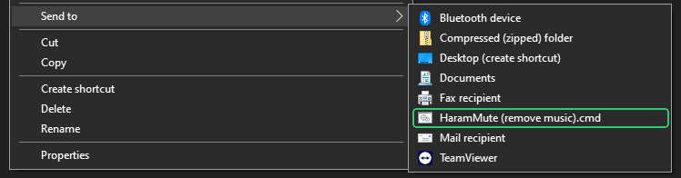

# HaramMute Anywhere

Remove background music from **any video** — local files on your PC or links from TikTok, Facebook, X, Instagram, Vimeo and 1000+ other sites — using the engine that ships with the [HaramMute](https://haram-mute.com) desktop app.

The HaramMute browser extension only works on YouTube. The desktop app behind it, though, runs a local server that can process any URL. `hm.py` is a small command-line tool that talks to that server directly, so you can use it on anything.

> **Not affiliated with HaramMute.** This is an independent helper script. It contains none of HaramMute's code or models. You need the official HaramMute desktop app installed for it to work.

## What it does

| Input | Output |
|---|---|
| Local video (`.mp4`, `.mkv`, `.webm`, `.mov`, …) | `name.nomusic.mp4` (or `.mkv`) next to the original — same video, music removed |
| Local audio (`.mp3`, `.m4a`, `.wav`, …) | `name.vocals.mp3` |
| Link from any [yt-dlp supported site](https://github.com/yt-dlp/yt-dlp/blob/master/supportedsites.md) | `*.vocals.mp3` in your Downloads folder |
| Link + `--video` | full music-free video in your Downloads folder |

Your original files are never modified.

## Requirements

- Windows with the **HaramMute desktop app** installed and running (tray icon visible)
- That's it — the script uses HaramMute's own bundled Python, ffmpeg and yt-dlp. No `pip install` needed.

## Install

Open **PowerShell** and paste:

```powershell
irm https://raw.githubusercontent.com/MohamedAmr51/harammute-anywhere/main/install.ps1 | iex
```

Or [download the repo as ZIP](https://github.com/MohamedAmr51/harammute-anywhere/archive/refs/heads/main.zip), extract it, and double-click **`install.bat`**.

The installer:
- checks that the HaramMute desktop app is installed
- installs to `%LOCALAPPDATA%\HaramMute-Anywhere` (separate from HaramMute, so its updates won't remove it)
- adds an `hm` command you can run from any terminal
- adds **HaramMute (remove music)** to the right-click **Send to** menu

### Uninstall

```powershell
powershell -ExecutionPolicy Bypass -File "$env:LOCALAPPDATA\HaramMute-Anywhere\uninstall.ps1"
```

HaramMute itself is not touched.

## Usage

### Right-click

Right-click any video → **Send to** → **HaramMute (remove music)**. A window shows progress, and the music-free copy is saved next to the original.



### Command line

Open a **new** terminal after installing:

```bat
:: a local video
hm "D:\Lectures\talk.mp4"

:: a link -> music-free audio
hm "https://www.tiktok.com/@user/video/123"

:: a link -> full music-free video
hm "https://x.com/user/status/123" --video

:: several at once, into a chosen folder
hm a.mp4 b.mkv "https://vimeo.com/123" --out D:\Clean
```

Tip: type `hm ` then drag a video into the window to paste its path.

### Options

| Option | Description |
|---|---|
| `--out DIR` | Output folder (default: next to the file, or Downloads for links) |
| `--video` | For links: also download the video and output a full music-free video |
| `--fresh` | Ignore HaramMute's cache and reprocess |
| `--install-sendto` / `--uninstall-sendto` | Add or remove the right-click "Send to" entry |
| `--version` | Show the version |

## How it works

```
hm.py ──POST /jobs {url}──▶ HaramMute engine (127.0.0.1:8765)
                               ├─ yt-dlp downloads the audio
                               ├─ UVR-MDX-NET separates vocals from music
                               └─ returns vocals.mp3
hm.py ◀──GET vocals.mp3────────┘
  └─ ffmpeg: original video + vocals  →  name.nomusic.mp4
```

For local files, `hm.py` briefly serves the file on a random `127.0.0.1` port so the engine can "download" it like any link. Nothing leaves your machine.

## Notes

- **Songs:** the model removes instruments but keeps voices, so a song becomes a cappella, not silence. It works best on speech over background music (lectures, vlogs, reels).
- **Edge/Chrome cookie warnings in HaramMute's log** are harmless — the engine tries each browser for login cookies before downloading. To skip straight to one that works:
  ```bat
  setx MUSIC_REMOVER_BROWSER_FOR_COOKIES brave
  ```
  then quit and restart HaramMute.
- **Private/login-only videos** need the browser you're logged into to be readable (close Chrome while running, since it locks its cookie file).

## Troubleshooting

| Message | Fix |
|---|---|
| `HaramMute engine not reachable` | Start the HaramMute app (tray icon), then retry |
| `file not found` | Check the path; the tool lists similarly named files to help. The extension can be left off |
| `HaramMute API 422` | The input isn't a valid file or `http(s)` link |
| `no progress for 15 min` | Check `%LOCALAPPDATA%\HaramMute\logs\tray_launcher.log` |

## License

[MIT](LICENSE) — applies to `hm.py` only. HaramMute itself is © its developer, all rights reserved.
